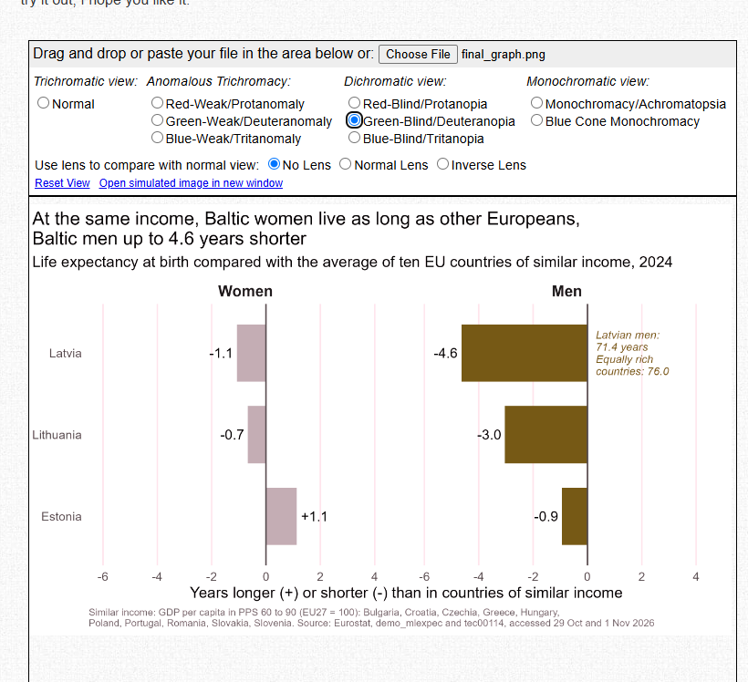

```{r}
#| label: setup-story
#| include: false
# Setup for working in this file on its own: loads the packages and the panel, and rebuilds the comparison group of 5.5.1.
# In the rendered report the earlier sections have already done this, so running it again changes nothing.
# include: false runs the chunk but does not show it in the report.
if (!requireNamespace("pacman", quietly = TRUE)) install.packages("pacman")   # install pacman only if it is missing, as in 1.1
pacman::p_load(tidyverse, here, janitor, gtsummary, knitr, scales, ggrepel, patchwork)   # the same packages as in 1.1
gap_panel <- read_csv(here("data", "clean", "gap_panel.csv"), show_col_types = FALSE)    # the panel saved in 4.5
gap_2024 <- gap_panel |> filter(year == 2024)                                             # the same as in 5.5.1
similar_income <- gap_2024 |> filter(!baltic, gdp_pps_index >= 60, gdp_pps_index <= 90)  # the ten comparison countries
```

# 6. The final graph

This section turns one graph from the exploration into the final graph of the project. The finding comes from Graph 12 (5.5.1): at the same level of income, Baltic women live about as long as women in other EU countries, while Baltic men live up to 4.6 years shorter. The graph is built in versions. Each version is saved as an image, and a log records what changed and why, so the way from the first draft to the final graph can be followed.

| Sub-section | What it does |
|-------------|--------------|
| 6.1 | Version 1: a first draft, with a problem |
| 6.2 | Version 2: the problem fixed |
| 6.3 | The final graph: refined for the message |
| 6.4 | Colour blind check |
| 6.5 | Log of the versions |
| 6.6 | Answer to the question |

## 6.1 Version 1: a first draft

The first draft shows the life expectancy of women and men directly: one bar per country and sex, for the three Baltic states and the average of the ten countries of similar income. It uses ggplot's default colours, a legend and a title that names the topic.

```{r}
#| label: show-graph-v1
#| fig-height: 4.5
# 6.1 Version 1: life expectancy of women and men, Baltic states and countries of similar income, 2024
baltic_and_similar <- gap_2024 |>
  filter(baltic) |>                                                   # the three Baltic states
  select(country, le_women, le_men) |>                                # their life expectancy, women and men
  bind_rows(tibble(country  = "Similar income (average)",            # add the comparison group as one more row
                   le_women = mean(similar_income$le_women),          # its average, women
                   le_men   = mean(similar_income$le_men))) |>        # its average, men
  pivot_longer(cols = c(le_women, le_men),                            # women and men into one column
               names_to = "sex", values_to = "life_expectancy")

baltic_and_similar |>
  ggplot(aes(x = country, y = life_expectancy, fill = sex)) +         # one bar per country, coloured by sex
  geom_col(position = "dodge") +                                      # women and men side by side
  labs(title = "Life expectancy by sex")                              # a title that names the topic, not the finding

ggsave(here("figures", "graph_v1.png"), width = 8, height = 4.5, dpi = 300)   # save the version as an image
```

**The problem:** the bars run from 0 to about 83 years, as bars must, so a difference of 3 to 5 years between Baltic men and men in equally rich countries is a few millimetres and almost invisible. The reader cannot see the finding. On top of that, the title says only the topic, the legend shows the technical names `le_men` and `le_women`, the y axis has no unit, and the default colours carry no meaning.

## 6.2 Version 2: show the difference

Version 2 fixes the main problem of version 1 by changing the measure. Instead of total life expectancy, each bar shows how many years longer or shorter women and men in a Baltic state live than women and men in the ten countries of similar income. The difference starts at 0, so a shortfall of a few years becomes the length of the bar. Women and men get one panel each, and the axis says what is measured, in years.

```{r}
#| label: show-graph-v2
#| fig-height: 4
# 6.2 Version 2: years longer or shorter than in countries of similar income, women and men, 2024
baltic_difference <- gap_2024 |>
  filter(baltic) |>                                                   # the three Baltic states
  mutate(Women = le_women - mean(similar_income$le_women),            # difference from the comparison group, women
         Men   = le_men   - mean(similar_income$le_men)) |>           # and men
  select(country, Women, Men) |>
  pivot_longer(cols = c(Women, Men),                                  # women and men into one column
               names_to = "sex", values_to = "difference") |>
  mutate(sex = factor(sex, levels = c("Women", "Men")))               # women in the left panel, men in the right

baltic_difference |>
  ggplot(aes(x = country, y = difference, fill = sex)) +              # one bar per country and sex
  geom_col() +                                                        # bar length = years longer (+) or shorter (-)
  geom_hline(yintercept = 0) +                                        # 0 = the same as in countries of similar income
  coord_flip() +                                                      # bars sideways, country names readable
  facet_wrap(~ sex) +                                                 # one panel for women, one for men
  labs(title = "Life expectancy compared with countries of similar income",   # still a topic, not a finding
       x = NULL,
       y = "Years longer (+) or shorter (-) than in countries of similar income")

ggsave(here("figures", "graph_v2.png"), width = 8, height = 4.5, dpi = 300)   # save the version as an image
```

**What is better, and what is still missing:** the finding is now visible: the men's bars point far to the left, the women's stay close to 0. Still missing: the title names a topic instead of the finding, the legend repeats what the panel titles already say, the default colours have no meaning, the countries are in alphabetical order instead of by size, there are no numbers on the bars, no annotation and no source.

## 6.3 The final graph

The final graph keeps the measure and the panels of version 2 and refines them for the message, following the course principles:

- **Ask and Tell:** the title states the finding. One annotation points to the evidence: Latvian men's life expectancy against that of men in equally rich countries.
- **Show:** the countries are ordered by the men's shortfall, largest at the top, and every bar carries its number. The axis names the measure and the unit.
- **Cut:** no legend, because the panel titles already say women and men. No minor grid lines, no horizontal grid lines.
- **Focus:** gray plus one colour. The men's bars are firebrick, the women's gray, so the eye goes to the men. Firebrick is much darker than the gray, so the two can be told apart by lightness alone, also with colour blindness. The message does not depend on colour: the panel titles, the numbers and the annotation carry it too.
- **Readable:** `theme_minimal(base_size = 14)`, large enough for a slide.

```{r}
#| label: show-final-graph
#| fig-height: 5.5
#| fig-width: 9
# 6.3 The final graph: Baltic women and men against countries of similar income, 2024
latvia_men <- gap_2024 |> filter(country == "Latvia") |> pull(le_men)   # 71.4 years, for the annotation
similar_men <- mean(similar_income$le_men)                                # 76.0 years, for the annotation

final_graph <- baltic_difference |>
  mutate(country = fct_reorder(country, difference,
                               .fun = min, .desc = TRUE)) |>          # order by the men's shortfall, largest at the top
  ggplot(aes(x = country, y = difference, fill = sex)) +
  geom_col(width = 0.7) +                                             # bar length = years longer (+) or shorter (-)
  geom_hline(yintercept = 0, colour = "gray30") +                     # 0 = the same as in countries of similar income
  geom_text(aes(label = sprintf("%+.1f", difference),                 # the number with its sign, one decimal
                hjust = if_else(difference < 0, 1.15, -0.15)),        # just outside the end of the bar
            size = 4.5) +
  geom_text(data = tibble(sex = factor("Men", levels = c("Women", "Men")),   # the annotation, only in the men's panel
                          country = "Latvia", difference = 0.3,
                          label = sprintf("Latvian men:\n%.1f years\nEqually rich\ncountries: %.1f",
                                          latvia_men, similar_men)),
            aes(label = label), hjust = 0, size = 3.6, lineheight = 0.9,
            colour = "firebrick", fontface = "italic") +
  coord_flip(clip = "off") +                                          # bars sideways, labels may reach past the panel edge
  facet_wrap(~ sex) +                                                 # one panel for women, one for men
  scale_fill_manual(values = c("Women" = "gray70",                    # gray for the women
                               "Men"   = "firebrick")) +              # one colour for the men, the message
  scale_y_continuous(limits = c(-6, 4.5),                             # room for the numbers and the annotation
                     breaks = seq(-6, 4, by = 2)) +
  labs(title = "At the same income, Baltic women live as long as other Europeans,\nBaltic men up to 4.6 years shorter",   # the finding
       subtitle = "Life expectancy at birth compared with the average of ten EU countries of similar income, 2024",
       x = NULL,
       y = "Years longer (+) or shorter (-) than in countries of similar income",
       caption = paste0("Similar income: GDP per capita in PPS 60 to 90 (EU27 = 100): Bulgaria, Croatia, Czechia, Greece, Hungary,\n",
                        "Poland, Portugal, Romania, Slovakia, Slovenia. Source: Eurostat, demo_mlexpec and tec00114, accessed 29 Oct and 1 Nov 2026")) +
  theme_minimal(base_size = 14) +                                     # a clean theme, text large enough for a slide
  theme(legend.position = "none",                                     # the panel titles already name women and men
        plot.title.position = "plot",                                 # the title starts at the left edge of the image
        plot.caption = element_text(hjust = 0, size = 9, colour = "gray40"),
        strip.text = element_text(face = "bold", size = 14),          # panel titles easy to read
        panel.grid.minor = element_blank(),                           # fewer lines that carry no data
        panel.grid.major.y = element_blank())

final_graph

ggsave(here("figures", "final_graph.png"), final_graph, width = 9, height = 5.5, dpi = 300)   # save the final graph
```

**What it shows:** at the same level of income, Baltic women live about as long as women in other EU countries, between 1.1 years shorter (Latvia) and 1.1 years longer (Estonia). Baltic men live shorter lives in all three countries: 4.6 years in Latvia, 3.0 in Lithuania and 0.9 in Estonia. The gap in the Baltic states is a gap of men.

## 6.4 Colour blind check

**Palette:** gray (`gray70`) for women and firebrick for men, the course's "gray plus one colour". The two colours differ strongly in lightness, so they stay apart even when the hue cannot be seen.

**Simulator:** Coblis, Color Blindness Simulator (https://www.color-blindness.com/coblis-color-blindness-simulator/), with the final graph uploaded and deuteranopia (red and green weakness, the most common type) selected.



**Result:** the screenshot shows the simulator set to Green-Blind/Deuteranopia. Firebrick turns olive brown and the gray turns a light pinkish gray. The men's bars are still much darker than the women's, so the two groups remain easy to tell apart. The message does not rely on colour alone: the panel titles say "Women" and "Men", every bar carries its number, and the annotation names Latvian men.

## 6.5 Log of the versions

| Version | File | What changed | Why |
|---|---|---|---|
| 1 | `figures/graph_v1.png` | First draft: total life expectancy of women and men as bars, default colours, a legend, a topic title | To see the raw numbers first. Problem: on bars from 0 to 83 years, a shortfall of 3 to 5 years is almost invisible |
| 2 | `figures/graph_v2.png` | The measure changed to the difference from countries of similar income, one panel for women and one for men, an axis label with the unit | A difference starts at 0, so the shortfall becomes the length of the bar and the finding is visible |
| Final | `figures/final_graph.png` | Finding as the title, gray plus firebrick, no legend, countries ordered by the men's shortfall, numbers on the bars, one annotation, source line, larger text | So the eye goes to the men, the graph can be read without colour, and it works on a slide |

## 6.6 Answer to the question

**Answer:** at the same level of income, Baltic women live about as long as women in other EU countries, but Baltic men live shorter lives, in 2024 up to 4.6 years shorter in Latvia (71.4 years against 76.0 in ten EU countries of similar income), and the gap goes most closely with men's extra deaths before 65 from heart disease and external causes. One limit: these are country averages, so they show which factors go together with the gap, not what causes it.

