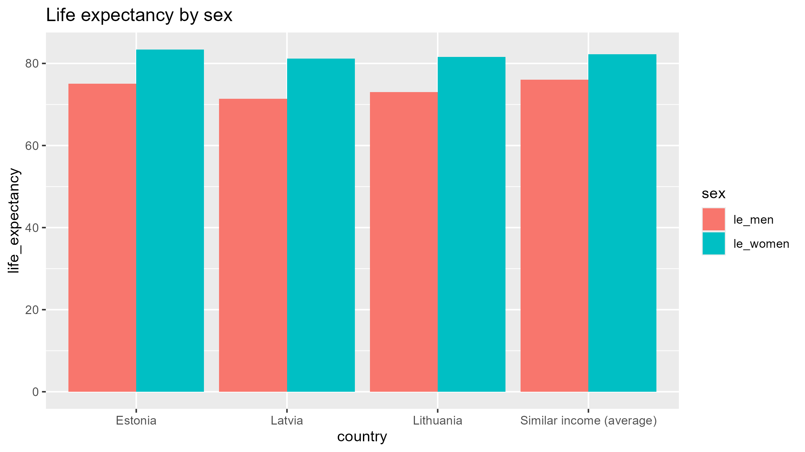
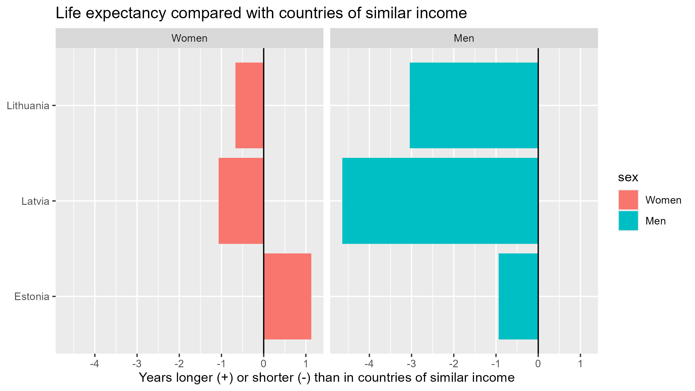
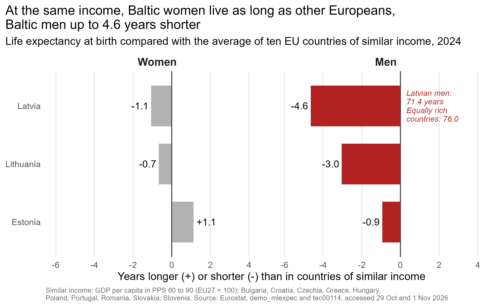

```{r}
#| label: demo-helper
#| include: false
# The demo runs the real code of the report. get_code() copies a chunk, by its label, from a section file,
# so the code on the slides is always the code in the report.
get_code <- function(file, label) {
  lines <- readLines(file, warn = FALSE)                             # the section file, line by line
  start <- which(lines == paste0("#| label: ", label))               # the line with the chunk's label
  stopifnot(length(start) == 1)                                      # the label must exist exactly once
  end   <- start + which(startsWith(lines[(start + 1):length(lines)], "```"))[1]   # the closing fence
  code  <- lines[(start + 1):(end - 1)]                              # everything between label and fence
  code[!startsWith(code, "#|")]                                      # without the other chunk options
}
```

```{r}
#| label: demo-setup
#| include: false
# Packages, as in Section 1 of the report
if (!requireNamespace("pacman", quietly = TRUE)) install.packages("pacman")
pacman::p_load(tidyverse, here, janitor, gtsummary, knitr, scales, ggrepel, patchwork)
```

# The story in one sentence {background-color="#1a1a1a"}

::: {style="font-size:1.3em; margin-top:60px;"}
At the same income, Baltic women live as long as other Europeans.

Baltic men live up to **4.6 years** shorter.
:::

::: {.note-small style="margin-top:60px;"}
This video shows the code behind that sentence: six tables, five checks, one panel, seventeen exploration graphs, one final graph.
:::

::: notes
Hi, I'm Jolanta. I'm travelling on the day of the presentations, so in this second video I show the work behind my finding: at the same income, Baltic women live as long as other Europeans, but Baltic men live up to 4.6 years shorter.

The whole project is one Quarto report, split into section files. Everything you'll see here is the real code from the report, run again for this video. I'll go through it in the same order I worked: gathering the data, cleaning it, combining the tables, exploring, and finally the graph.
:::

## The pipeline

::: {.pipeline}
[1 · Gather<br>6 tables via API]{.step}[→]{.arrow}[2 · Clean<br>5 checks each]{.step}[→]{.arrow}[3 · Combine<br>gap_panel, 270 rows]{.step}[→]{.arrow}[4 · Explore<br>17 graphs]{.step}[→]{.arrow}[5 · Final graph<br>v1 → v2 → final]{.step .key}
:::

::: {style="font-size:0.8em; margin-top:40px;"}
`data/raw/` holds the downloads, never edited · `data/clean/` holds what the code makes · every decision is written in the report and in `notes/decisions.md`
:::

::: notes
This is the whole pipeline. Each step uses only the output of the step before. The raw downloads stay untouched in data raw. Everything in data clean is made by the code, so it can always be made again. And every decision I took, like which countries to keep, is written down in the report with its reason.
:::

# 1 · Gathering the data {background-color="#1a1a1a"}

[From a link to a raw file, by code]{.kicker}

## Building the download link

```{r}
#| label: demo-eu-codes
#| include: false
#| code: !expr get_code("_2_gathering.qmd", "show-eu-codes")
```

```{r}
#| label: demo-le-url
#| code: !expr get_code("_2_gathering.qmd", "show-life-expectancy-url")
```

::: notes
I didn't download anything by hand. Eurostat has an API, a web address that returns data. paste0 glues the link together: the API address, the table code demo underscore mlexpec, and then the choices: annual data, in years, women and men, at birth, all countries, 2015 to 2024. Because the choices are in the link, anyone can rerun this and get exactly the same file.
:::

## Download once, and check what came back

```{r}
#| label: demo-le-download
#| code: !expr get_code("_2_gathering.qmd", "show-life-expectancy-download")
```

::: notes
The download runs only once. file dot exists checks whether the file is already in data raw, and the exclamation mark means "not". So rerunning the report never overwrites the original download. mode wb copies the file byte for byte.

For the bigger tables I also check the first line of the file. Eurostat sometimes sends a waiting message instead of data, and a real Eurostat file always starts with the word DATAFLOW. If not, the file is deleted and the code stops with a clear message. That actually happened to me with the deaths table.
:::

## Load and look

```{r}
#| label: demo-le-load
#| output-location: slide
#| code: !expr get_code("_2_gathering.qmd", "show-life-expectancy-load")
```

::: notes
read csv reads the file. Eurostat writes missing values as a colon, so I tell R that a colon means missing. That's not cleaning, it's only reading the file correctly. Then glimpse shows every column and its type.

(next slide) 906 rows and 11 columns. OBS VALUE, the life expectancy, is a number, as it should be. The column names are still Eurostat's own, because in this section I change nothing.
:::

# 2 · Cleaning {background-color="#1a1a1a"}

[Readable names, and five checks on every table]{.kicker}

## Readable names

```{r}
#| label: demo-le-names
#| code: !expr get_code("_3_1_life_expectancy.qmd", "show-life-expectancy-names")
```

::: notes
Cleaning starts here, in Section 3. clean names makes the names lowercase with underscores, so TIME PERIOD becomes time period. Then rename gives them names that say what they hold: geo becomes country code, obs value becomes life expectancy. In rename, the new name comes first, then the old one.
:::

## Five checks on every table · the flags

```{r}
#| label: demo-le-flags
#| code: !expr get_code("_3_1_life_expectancy.qmd", "show-life-expectancy-flags")
```

::: notes
Every table goes through the same five checks from class 3: types, missing values, ranges, duplicates and row counts. Here's one example. Eurostat marks some values with letters: e for estimated, p for provisional, b for a break in the series. count shows how many of each. NA here means "no flag", not a missing value. I kept the flagged values and wrote about them in the limits.
:::

## Five checks · the range

```{r}
#| label: demo-le-range
#| output-location: slide
#| fig-width: 11
#| fig-height: 5.5
#| code: !expr get_code("_3_1_life_expectancy.qmd", "show-life-expectancy-range")
```

::: notes
Check 3, the range. One number, so a histogram, as in class 10. Women and men in two panels. Life expectancy at birth in Europe should lie between about 65 and 90 years, the dashed lines.

(next slide) All values are inside. If I had picked the wrong age class, for example life expectancy at 65, the values would be around 20, and this graph would show it immediately.
:::

## Five checks · the row counts

```{r}
#| label: demo-le-rows
#| output-location: slide
#| fig-width: 11
#| fig-height: 6
#| code: !expr get_code("_3_1_life_expectancy.qmd", "show-life-expectancy-rows")
```

::: notes
Check 5, the row counts. Ten years and two sexes, so every country should have 20 rows. count counts them, and the bar chart shows each country, with the EU member states in orange.

(next slide) All 27 EU countries are complete. The file also holds EU totals and non-EU countries, like Norway or Albania. Those have to go.
:::

## Apply the decisions

```{r}
#| label: demo-le-eu
#| code: !expr get_code("_3_1_life_expectancy.qmd", "show-life-expectancy-eu")
```

```{r}
#| label: demo-le-select
#| include: false
#| code: !expr get_code("_3_1_life_expectancy.qmd", "show-life-expectancy-select")
```

::: notes
Only after the checks do I change the data. filter keeps the 27 member states, using one list of codes, eu codes, that I wrote once and reuse everywhere. Note that Greece is EL in Eurostat, not GR. I check the row count before and after: 906 rows before, 540 after, exactly 27 countries times 2 sexes times 10 years. Then select keeps the five columns I need.

I did the same for all six tables. The deaths table was the hardest: 93 causes of death, and the code for "all causes" changed between years, so I had to merge two codes into one.
:::

# 3 · Combining the tables {background-color="#1a1a1a"}

[Six tables become one panel of 270 rows]{.kicker}

```{r}
#| label: demo-combining-setup
#| include: false
#| code: !expr get_code("_4_combining.qmd", "setup-combining")
```

## Women and men side by side

```{r}
#| label: demo-le-wide
#| code: !expr get_code("_4_combining.qmd", "show-life-expectancy-wide")
```

::: notes
The clean tables are long: one row for women, one for men. To compute the gap, women and men must sit in the same row. pivot wider does that, from class 7: the values F and M become two columns. rename gives them clear names, and mutate computes the gap, women minus men. 540 rows become 270: one row per country and year.
:::

```{r}
#| label: demo-wides
#| include: false
#| code: !expr c(get_code("_4_combining.qmd", "show-healthy-life-years-wide"), get_code("_4_combining.qmd", "show-education-wide"), get_code("_4_combining.qmd", "show-deaths-by-cause"), get_code("_4_combining.qmd", "show-deaths-all-causes"))
```

## Joining, and checking every join

```{r}
#| label: demo-join-hly
#| code: !expr get_code("_4_combining.qmd", "show-join-healthy-life-years")
```

::: notes
Then the joins, from class 8. left join keeps every row of the life expectancy table and adds the new columns where country and year match. I used left join on purpose: inner join would have dropped every row with a gap in any table, including life expectancy, my main number.

After every join I check two things: the row count must still be 270, and anti join lists the rows that found no partner. Here, Luxembourg in 2023 and 2024, which has no healthy life years. So every NA in the panel is explained.
:::

```{r}
#| label: demo-joins-rest
#| include: false
#| code: !expr c(get_code("_4_combining.qmd", "show-join-gdp"), get_code("_4_combining.qmd", "show-join-education"))
```

## The join that shows a missing year

```{r}
#| label: demo-join-deaths
#| code: !expr get_code("_4_combining.qmd", "show-join-deaths")
```

```{r}
#| label: demo-joins-last
#| include: false
#| code: !expr c(get_code("_4_combining.qmd", "show-join-alcohol"), get_code("_4_combining.qmd", "show-country-names"))
```

::: notes
The deaths join tells a story too. anti join with count by year shows exactly 27 rows without deaths data, all in 2024. Eurostat hasn't published the 2024 deaths yet. Those rows stay NA, never zero.

After the deaths I joined GDP, education and alcohol the same way.
:::

## The panel is ready

```{r}
#| label: demo-baltic
#| code: !expr get_code("_4_combining.qmd", "show-baltic")
```

::: notes
Last, I add the country names and one column, baltic, which is TRUE for Estonia, Latvia and Lithuania. With this one column, every graph can highlight the Baltic states. The result: 270 rows, 18 columns, saved as gap panel dot csv. This is the table all the exploration starts from.
:::

# 4 · Exploring {background-color="#1a1a1a"}

[Where is the gap, and what goes with it?]{.kicker}

```{r}
#| label: demo-explore-load
#| include: false
#| code: !expr get_code("_5_exploration.qmd", "show-explore-load")
```

## Where is the gap largest?

```{r}
#| label: demo-graph-1
#| output-location: slide
#| fig-width: 11
#| fig-height: 6.5
#| code: !expr get_code("_5_1_gap_and_causes.qmd", "show-graph-1")
```

::: notes
In the exploration I asked one question per graph, seventeen graphs in total. The first question: where is the gap largest? One number per country, so a ranked bar chart. fct reorder sorts the countries by their gap, and the Baltic states are red, all the others gray.

(next slide) The three Baltic states have the three largest gaps in the EU. Latvia 9.8 years. The dashed line is the EU average.
:::

## Has the gap changed?

```{r}
#| label: demo-graph-4
#| output-location: slide
#| fig-width: 11
#| fig-height: 6.5
#| code: !expr get_code("_5_1_gap_and_causes.qmd", "show-graph-4")
```

::: notes
Second question: did the gap change over time? Time, so a line chart, one line per country.

(next slide) In most countries the gap narrowed. Lithuania narrowed it the most in the whole EU. Latvia's gap didn't shrink. Two neighbours, two paths.
:::

## Which deaths make up the gap?

```{r}
#| label: demo-graph-5
#| output-location: slide
#| fig-width: 11
#| fig-height: 6.5
#| code: !expr get_code("_5_1_gap_and_causes.qmd", "show-graph-5")
```

::: notes
Third question: which causes of death make up the extra deaths of men under 65? For each chapter of causes, men's death rate minus women's, Baltic states against the rest of the EU.

(next slide) Heart and circulatory diseases are the biggest part, as I expected. But external causes come close: poisoning, suicide, drowning. That was the surprise, and several of them point to alcohol.
:::

## Which factors go with the gap?

```{r}
#| label: demo-factors
#| include: false
#| code: !expr get_code("_5_4_factors.qmd", "show-factors-2023")
```

```{r}
#| label: demo-graph-7
#| output-location: slide
#| fig-width: 11
#| fig-height: 6
#| code: !expr get_code("_5_4_factors.qmd", "show-graph-7")
```

::: notes
Then I tested each factor with a scatter plot, two numbers, so a scatter, as in class 10. Here: men's extra deaths from heart disease against the gap. geom smooth with method lm draws the trend line.

(next slide) Each dot is a country. The more extra heart deaths among men, the larger the gap. The correlation is 0.87, and Latvia and Lithuania sit near the top.
:::

## All factors, in numbers

```{r}
#| label: demo-correlations
#| code: !expr get_code("_5_4_factors.qmd", "show-correlations")
```

::: notes
I did the same for every factor and put the correlations in one table, with group by and summarise. And always a second column: without the Baltic states, to see if three countries alone make the pattern.

The death factors go with the gap at about 0.9, also without the Baltic states. GDP goes the other way: richer countries have smaller gaps. And education looked strong at 0.52, but without the Baltic states it falls to 0.22. That's a dead end, and I kept it in the appendix, because a weak result is also a result.
:::

## Could it be chance?

```{r}
#| label: demo-factors-all
#| include: false
#| code: !expr get_code("_5_6_men_and_robustness.qmd", "show-factors-all-years")
```

```{r}
#| label: demo-robustness
#| code: !expr get_code("_5_6_men_and_robustness.qmd", "show-robustness")
```

::: notes
With only 27 countries, I wanted to know if the pattern could be chance, and if it holds in another year. cor test gives a confidence interval and a p value for each correlation. I compared 2019, before COVID, with 2023.

The death factors are strong in both years, with p values below 0.0001. So it's not chance, and it's not a COVID effect.
:::

# 5 · The final graph {background-color="#1a1a1a"}

[Version 1, version 2, final]{.kicker}

## Version 1 → version 2 → final

::: {.columns}
::: {.column width="50%"}

:::
::: {.column width="50%"}

:::
:::

::: notes
For the final graph I chose the clearest finding, the comparison with equally rich countries. My first version showed total life expectancy, and the difference was almost invisible on bars from zero. Version 2 shows the difference instead, and the finding appears.
:::

## The final graph

{width="92%"}

::: notes
Then I refined it: the finding as the title, gray for the women and one colour, red, for the men, the countries ordered by the men's shortfall, a number on every bar, and one annotation for Latvian men: 71.4 years against 76. I checked it in a colour blindness simulator, and the numbers and panel titles carry the message without colour.
:::

## {background-color="#1a1a1a"}

::: {style="font-size:1.3em; margin-top:80px;"}
At the same income, **Baltic women keep up with Europe.**

**Baltic men don't**, and in Latvia they live **4.6 years** shorter.
:::

::: {.note-small style="font-size:0.75em; margin-top:60px;"}
Six tables · five checks each · one panel of 270 rows · seventeen exploration graphs · one final graph
:::

::: notes
So that's the work behind the graph: six tables, five checks on each, one panel of 270 rows, seventeen exploration graphs, and one final graph. At the same income, Baltic women keep up with Europe. Baltic men don't, and in Latvia they live 4.6 years shorter. Thank you for watching.
:::
