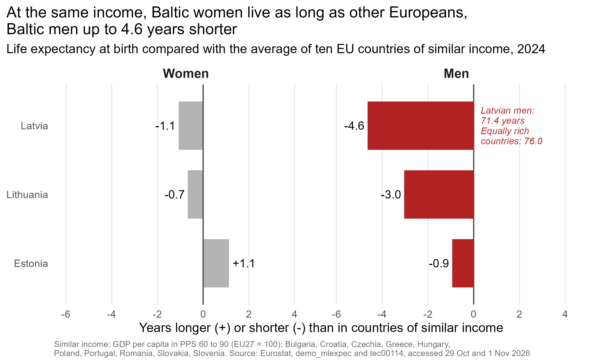

# At the same income, Baltic women live as long as other Europeans, Baltic men up to 4.6 years shorter

**Name:** Jolanta Stutane **Date:** 9th November 2026

## Question

How much shorter is men's life expectancy at birth than women's in the Baltic states (Estonia, Latvia, Lithuania) compared with the rest of the EU, 2015 to 2024, and which causes of death go with the gap?

Women live longer than men in every EU country, but not by the same margin. In 2024 Latvian women outlived Latvian men by 9.8 years, almost twice the EU average of 5.5. I live in Latvia, so I wanted to know what sits behind that number.

## Data

Six tables for the 27 EU member states: life expectancy, healthy life years, deaths by cause under 65, GDP per capita and tertiary education from Eurostat, and alcohol consumption from WHO, via Our World in Data (see `data/raw/SOURCE.md`). Joined into one table with one row per country and year, 270 rows for 2015 to 2024.

## How I found it

1. **My guess.** Before looking at the data I wrote down: Baltic men die earlier mainly because of heart disease before 65.
2. **Which deaths?** Heart disease was the biggest part of men's extra early deaths, but external causes came close: accidental poisoning was six times the EU level, and suicide, drowning and liver disease were far higher too. Several of these point to alcohol. Across the EU, the gap goes closely with these deaths (correlations 0.87 and 0.91).
3. **Is it just poverty?** Richer countries have smaller gaps, but the Baltic gaps were about two years larger than their income would predict. A dead end: education seemed to matter, but only because of the Baltic states themselves.
4. **Women or men?** Comparing the Baltic states only with equally rich countries gave the clearest picture, the final graph below.
5. **Two neighbours, two paths.** Lithuania narrowed its gap more than any other EU country (-1.8 years), as its men's early deaths and its drinking fell. Latvia's men didn't improve, and since 2021 Latvia has had the largest gap in the EU.

## Answer

The gap is a gap of men: at the same level of income, Baltic women live about as long as women in other EU countries, but Latvian men live 4.6 years shorter than men there.

## Evidence

Each bar compares a Baltic state with the average of ten EU countries of similar income (GDP per person 60 to 90% of the EU average), so income is taken out of the comparison. A bar at 0 means "the same as in equally rich countries".

- **Women (gray)** are all within about a year of 0: Latvia -1.1, Lithuania -0.7, Estonia +1.1 years.
- **Men (red)** fall behind in all three countries: Latvia -4.6, Lithuania -3.0, Estonia -0.9 years. Latvian men live 71.4 years, against 76.0 in the comparison group.
- **The result holds** with other income bands: Baltic men always fall 1.9 to 4.0 years further behind than Baltic women.

## Limits

- Country averages show what goes together, not what causes it, and nothing about individual men.
- Life expectancy is a snapshot of one year's death rates, not a forecast.
- The alcohol data ends in 2020 and isn't split by sex, so it can't show heavy drinking among men.
