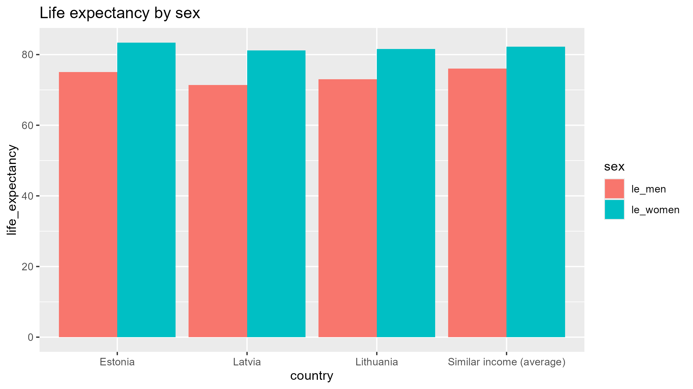
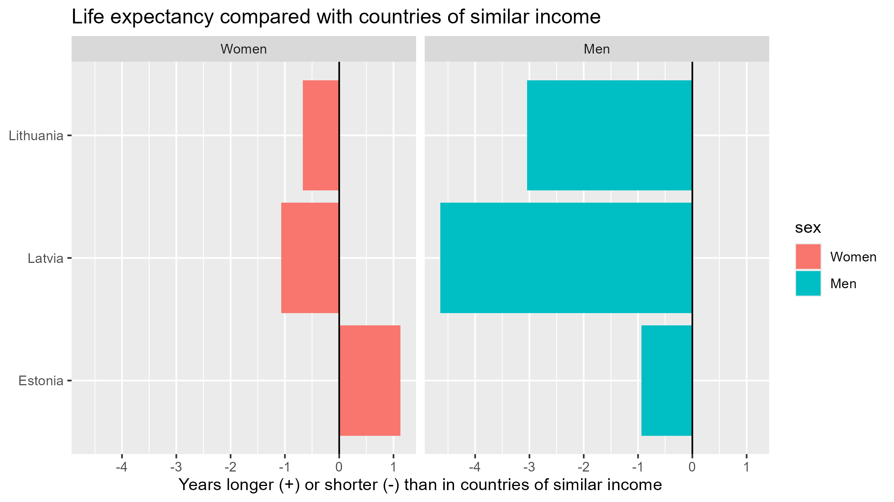

```{r}
#| label: talk-setup
# Setup: packages, data and one function that draws the final graph layer by layer
if (!requireNamespace("pacman", quietly = TRUE)) install.packages("pacman")   # install pacman only if missing
pacman::p_load(tidyverse, here, knitr)                                        # data, charts, paths, tables

gap_2024 <- read_csv(here("data", "clean", "gap_panel.csv"), show_col_types = FALSE) |>
  filter(year == 2024)                                                        # the latest year
similar_income <- gap_2024 |>
  filter(!baltic, gdp_pps_index >= 60, gdp_pps_index <= 90)                   # the ten comparison countries

baltic_difference <- gap_2024 |>
  filter(baltic) |>
  mutate(Women = le_women - mean(similar_income$le_women),                    # years longer (+) or shorter (-), women
         Men   = le_men   - mean(similar_income$le_men)) |>                   # and men
  select(country, Women, Men) |>
  pivot_longer(c(Women, Men), names_to = "sex", values_to = "difference") |>
  mutate(sex = factor(sex, levels = c("Women", "Men")),
         country = fct_reorder(country, difference, .fun = min, .desc = TRUE))  # Latvia on top

note <- tibble(sex = factor("Men", levels = c("Women", "Men")), country = "Latvia", difference = 0.3,
               label = sprintf("Latvian men:\n%.1f years\nEqually rich\ncountries: %.1f",
                               gap_2024$le_men[gap_2024$country == "Latvia"], mean(similar_income$le_men)))

# One function, so every frame has the same axes and nothing jumps between slides
story_graph <- function(show = c("Women", "Men"), annotate = FALSE, title = NULL) {
  shown <- baltic_difference |> filter(sex %in% show)                         # only the bars of this frame
  p <- ggplot(baltic_difference, aes(x = country, y = difference, fill = sex)) +
    geom_blank() +                                                            # keeps both panels and all countries
    geom_hline(yintercept = 0, colour = "gray30") +                           # 0 = the same as in equally rich countries
    geom_col(data = shown, width = 0.7) +
    geom_text(data = shown, aes(label = sprintf("%+.1f", difference),
                                hjust = if_else(difference < 0, 1.15, -0.15)), size = 6) +
    coord_flip(clip = "off") +
    facet_wrap(~ sex) +
    scale_fill_manual(values = c("Women" = "gray70", "Men" = "firebrick")) +  # gray plus one colour
    scale_y_continuous(limits = c(-6, 4.5), breaks = seq(-6, 4, 2)) +
    labs(title = title, x = NULL,
         y = "Years longer (+) or shorter (-) than in countries of similar income",
         caption = "Life expectancy at birth, 2024. Similar income: GDP per capita in PPS 60 to 90 (EU27 = 100). Source: Eurostat, demo_mlexpec and tec00114") +
    theme_minimal(base_size = 20) +
    theme(legend.position = "none", plot.title.position = "plot",
          plot.caption = element_text(hjust = 0, size = 11, colour = "gray40"),
          strip.text = element_text(face = "bold", size = 22),
          panel.grid.minor = element_blank(), panel.grid.major.y = element_blank())
  if (annotate) {
    p <- p + geom_text(data = note, aes(label = label), hjust = 0, size = 5.5,
                       lineheight = 0.9, colour = "firebrick", fontface = "italic")
  }
  p
}
```

# 1 · The question {background-color="#1a1a1a"}

::: {style="color:white; text-align:center; margin-top:40px;"}
[9.8 years]{.accent style="font-size:3.6em; font-weight:bold;"}

[That is how much longer Latvian women live than Latvian men, almost twice the EU average.]{style="font-size:1.2em;"}
:::

::: notes
(0:00) In every EU country, women live longer than men. That's normal. But in Latvia, where I live, women outlive men by almost ten years. That's nearly twice the EU average. You see it around you: at a family table, the grandmothers are often there, the grandfathers much less.
:::

## The question, and the answer

::: {style="font-size:1.3em; margin-top:40px;"}
How much shorter is men's life expectancy at birth than women's in the **Baltic states**, compared with the rest of the EU, **2015 to 2024**, and which causes of death go with the gap?
:::

::: {.accent style="font-size:1.25em; margin-top:50px;"}
**At the same income, Baltic women live as long as other Europeans. Baltic men live up to 4.6 years shorter.**
:::

::: notes
(0:10) So my question was: how much shorter do Baltic men live than Baltic women, compared with the rest of the EU, and why?

Here is the answer straight away: at the same income, Baltic women live as long as other Europeans, but Baltic men live up to 4.6 years shorter.

Now let me show you how I got there, step by step.
:::

# 2 · The data {background-color="#1a1a1a"}

[Six tables, all downloaded by code]{.kicker}

## Six tables, downloaded by code {.smaller}

| Table | Source | Raw rows |
|---|---|---|
| Life expectancy at birth, by sex | Eurostat `demo_mlexpec` | 906 |
| Healthy life years, by sex | Eurostat `hlth_hlye` | 618 |
| Deaths under 65, by cause and sex | Eurostat `hlth_cd_asdr2` | 43 902 |
| GDP per capita (EU = 100) | Eurostat `tec00114` | 430 |
| Tertiary education, by sex | Eurostat `sdg_04_20` | 730 |
| Alcohol per person | WHO, via Our World in Data | 4 164 |

::: {.note-small style="font-size:0.75em;"}
Downloaded through the Eurostat API from R, saved untouched in `data/raw/`, documented in `SOURCE.md` (source, link, licence, date).
:::

::: notes
(0:30) So where does an answer come from? From data. I used six tables: five from Eurostat, the EU's statistics office, and one from the World Health Organization. Life expectancy, healthy years, deaths by cause, income, education and alcohol.

I didn't click through the website. My R code downloads each table through Eurostat's API, so anyone can rerun it and get the same data. The original files stay untouched in data raw, and SOURCE.md says where each one comes from.
:::

## What one raw file looks like

::: {.big-table}
```{r}
# The first file as it arrived: Latvia, 2024, women and men
read_csv(here("data", "raw", "demo_mlexpec.csv"), show_col_types = FALSE) |>
  filter(geo == "LV", TIME_PERIOD == 2024) |>
  select(geo, sex, age, TIME_PERIOD, OBS_VALUE, OBS_FLAG) |>
  kable()
```
:::

::: {style="font-size:0.85em; margin-top:30px;"}
One row = one country, one sex, one year. `Y_LT1` = age under 1, so life expectancy **at birth**. The gap for Latvia: 81.2 − 71.4 = **9.8 years**.
:::

::: notes
(0:55) This is what a raw file looks like. One row is one country, one sex and one year. Here's Latvia in 2024: women 81.2 years, men 71.4. The age code Y LT1 means "under one year", so it's life expectancy at birth. 81.2 minus 71.4: there are the 9.8 years from the start, hidden in two rows of a CSV file.
:::

# 3 · Exploration and preparation {background-color="#1a1a1a"}

[Check every table, then build one panel]{.kicker}

## Checking before trusting

::: {.columns}
::: {.column width="50%"}
**Five checks on every table**

1. Types: numbers are numbers ✓
2. Missing values: counted, never set to 0
3. Ranges: all plausible ✓
4. Duplicates: none ✓
5. Row counts: every EU country complete
:::
::: {.column width="50%"}
**What I found**

- Greece is `EL`, not `GR`
- EU totals and non-EU countries mixed in
- Luxembourg: no healthy years for 2023 and 2024
- Deaths end in 2023
- Alcohol ends in 2020
:::
:::

::: notes
(1:15) But raw data can't be trusted blindly. So before using it, I ran the same five quality checks on every table: types, missing values, ranges, duplicates and row counts.

They found real things. Eurostat writes Greece as EL, not GR, which would break a join. The files mix in EU totals and non-EU countries. Luxembourg is missing two years of healthy life years, and I kept those missing, I didn't fill them with zero. And the deaths and alcohol data end earlier than the others.
:::

## Preparing the data for the graph

::: {.pipeline}
[6 raw<br>tables]{.step}[→]{.arrow}[keep<br>27 EU countries]{.step}[→]{.arrow}[women and men<br>side by side]{.step}[→]{.arrow}[join on<br>country and year]{.step}[→]{.arrow}[gap_panel<br>270 rows]{.step}[→]{.arrow}[2024, ten<br>equally rich countries]{.step}[→]{.arrow}[difference<br>from that group]{.step .key}
:::

::: {style="font-size:0.85em; margin-top:30px;"}
**Why equally rich countries?** The Baltic states are poorer than most of the EU. Comparing with countries of similar income (GDP per person 60 to 90% of the EU average) takes income out of the picture.
:::

::: notes
(1:45) Then I prepared the data. I kept only the 27 EU countries, put women and men side by side with pivot wider, and joined all tables on country and year. The result is one table with 270 rows: 27 countries times 10 years.

And here's the key idea of the whole project. The Baltic states are poorer than most of the EU. So if Baltic men die earlier, someone could simply say: it's poverty. To test that, I compared each Baltic state only with the ten EU countries that are about as rich: Bulgaria, Croatia, Czechia, Poland and so on. If it's only poverty, the Baltic states should look just like them.
:::

# 4 · Building the graph {background-color="#1a1a1a"}

[From a first draft to the final graph]{.kicker}

## Version 1: the problem

{width="85%"}

::: notes
(2:20) My first version showed total life expectancy as bars. The problem: bars start at zero, so a difference of four years on an 80-year bar is almost invisible. The title only names the topic, and the legend shows the code names of my columns.
:::

## Version 2: show the difference

{width="85%"}

::: notes
(2:40) So in version 2 I changed the measure: each bar now shows the difference from equally rich countries. Zero means the same. Now the finding is visible. But the colours still mean nothing, the legend repeats the panel titles, and there are no numbers.
:::

## Refining: the women

```{r}
#| fig-width: 12
#| fig-height: 6
story_graph(show = "Women")
```

::: notes
(3:00) Then I refined it. Gray for the women. All three countries are within about one year of zero: Latvia minus 1.1, Lithuania minus 0.7, Estonia plus 1.1. Baltic women live about as long as women in comparable countries. So for the women, the poverty explanation works: they fit the European pattern.
:::

## Refining: the men

```{r}
#| fig-width: 12
#| fig-height: 6
story_graph(show = c("Women", "Men"))
```

::: notes
(3:20) One colour, red, for the men, the message. And now the men. Every bar goes to the left: Estonia almost one year, Lithuania three, Latvia 4.6 years shorter. Same countries, same income, but the men fall behind. That was the moment the story became clear to me.
:::

## Refining: one annotation

```{r}
#| fig-width: 12
#| fig-height: 6
story_graph(show = c("Women", "Men"), annotate = TRUE)
```

::: notes
(3:35) One annotation points to the evidence: Latvian men live 71.4 years, men in equally rich countries 76.
:::

## {background-color="#ffffff"}

```{r}
#| fig-width: 12
#| fig-height: 6.8
story_graph(show = c("Women", "Men"), annotate = TRUE,
            title = "At the same income, Baltic women live as long as other Europeans,\nBaltic men up to 4.6 years shorter")
```

::: notes
(3:45) And the title states the finding. That's the final graph. I also checked it in a colour blindness simulator: the red stays much darker than the gray, and the numbers and panel titles carry the message without colour.
:::

# 5 · The answer {background-color="#1a1a1a"}

[Why the men, and what the data cannot say]{.kicker}

## Why the men?

::: {style="font-size:1.1em;"}
I guessed **heart disease**. That was only half the story.

Baltic men under 65 also die far more often from **external causes**:

- accidental poisoning: **6 times** the EU level
- suicide and drowning: much higher too

Several of these point to **alcohol**.
:::

::: notes
(4:00) Before I opened the data, I guessed heart disease. That was right, but only half the story. Baltic men under 65 die from accidental poisoning six times as often as the EU average, and suicide and drowning are much higher too. Several of these point to alcohol.
:::

## The answer, and one limit

::: {style="font-size:1.35em; margin-top:40px;"}
At the same income, **Baltic women keep up with Europe.**

**Baltic men don't**, and in Latvia they live **4.6 years** shorter.
:::

::: {.note-small style="font-size:0.95em; margin-top:50px;"}
Limit: these are country averages. They show what goes together, not what causes it.
:::

::: notes
(4:25) So, back to the family table with the missing grandfathers. The answer: at the same income, Baltic women keep up with Europe. Baltic men don't, and in Latvia they live 4.6 years shorter.

One limit: these are country averages. They show what goes together, not what causes it.

Thank you. (about 4:45)
:::
